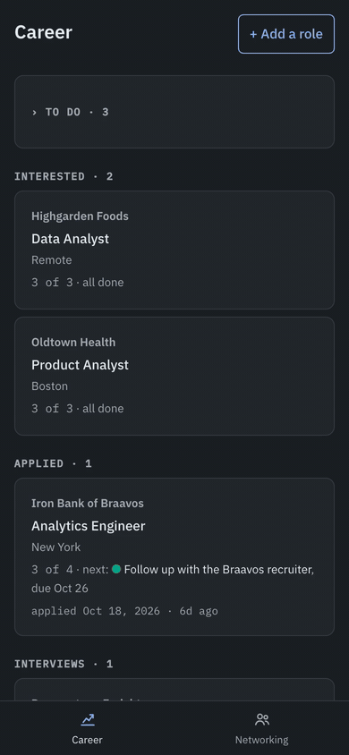
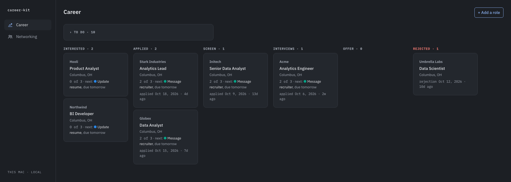
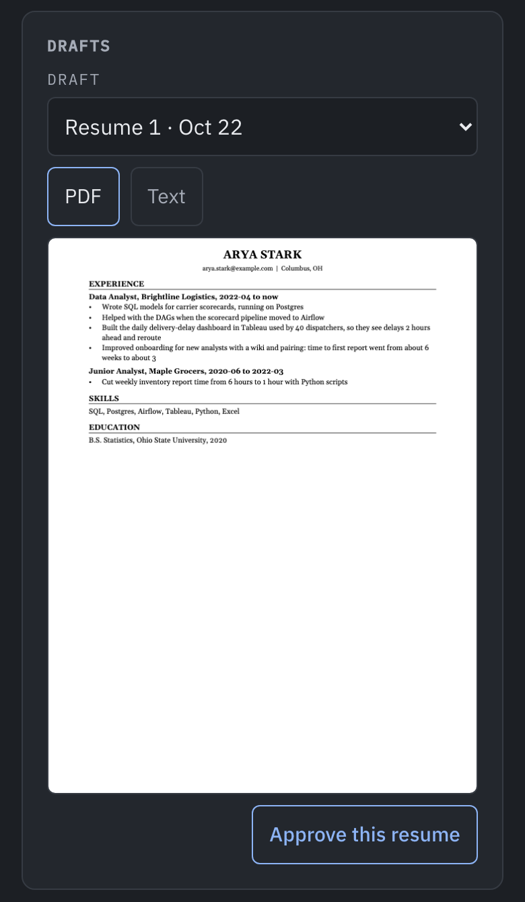

# career-kit

[](https://github.com/shreyahprasad/career-kit/actions/workflows/ci.yml)

[](docs/images/demo.mp4)

Looking for a job, or the next step in your career, while working full time is a second job.
Every role wants its own resume and cover letter, every application needs a follow-up, and the
people who could refer you get lost in your texts.

career-kit puts that work in one place you message from your phone. Tell it about a role and it
keeps the posting, where you stand, and what to do next. Ask for a resume or cover letter and it
tailors one to that role using only facts you have confirmed, then shows you the PDF to approve.

It also keeps track of your network: who you have talked to, what they said, and when to follow
up. Referrals are often the fastest way into a job, so networking gets its own page instead of
being an afterthought.

The code is free; you need a Claude plan to run it. Setup is a few steps in Terminal, done once.

There is also a web page with the board, for when you want to see everything at once.



Your data is stored only in `data/` on your own computer and is never in git. What Claude
reads to help you (a posting, your profile, a resume) is sent to Anthropic, as in any Claude
Code session.

## What you need

New to Terminal? The [setup wizard](https://shreyahprasad.github.io/career-kit/setup/) walks
through every step below with commands to copy.

- A Mac that can stay on (an old laptop or a Mac mini is fine), with [Homebrew](https://brew.sh).
- [Claude Code](https://code.claude.com/docs/en/setup), signed in with a Claude Pro, Max, Team or
  Enterprise plan, not an API key. Remote Control, which lets you use it from your phone, needs
  one of those; on Team and Enterprise, an Owner has to turn it on first.
- The Claude app on your phone.
- A GitHub account.
- Recommended: [Tailscale](https://tailscale.com) on the Mac and the phone. Without it you can
  talk to Claude from your phone but not open the page there, and the page is where you see a
  draft as a PDF and approve it.

## Get your own copy

This repo is a template. Your copy is your own private repo, so your changes (your colors, your
starter todos) are yours.

1. On this repo's GitHub page, click **Use this template**, then **Create a new repository**.
   Pick **Private**.
2. On the Mac, in Terminal:

   ```sh
   git clone https://github.com/<you>/<your-repo>.git career-kit
   cd career-kit
   ```

## Set it up (once)

```sh
brew install uv fnm pnpm
./setup.sh
```

`setup.sh` checks those tools, installs what the code needs, builds the page, and makes empty
databases in `data/`. It is safe to run again; it never touches databases that are already there.

## Start it

```sh
./start.sh
```

Open http://127.0.0.1:5180 on the Mac to see the board. `./stop.sh` stops everything. Run
`./start.sh` again after the Mac restarts (or just ask Claude to, below).

To have it start by itself whenever you log in to the Mac, run `scripts/launchagent.sh install`
once (`scripts/launchagent.sh remove` undoes it). It is optional and `setup.sh` never turns it on.
It only starts the servers: the Remote Control session below still needs its command after a
restart.

## Talk to it from your phone

In the `career-kit` folder:

```sh
claude --remote-control "Job search"
```

The first time, it asks you to trust the folder and to turn on Remote Control: say yes to both.
Then open the Claude app on your phone and find **Job search** in your Code sessions (or type
`/remote-control` in the terminal and scan the QR code it shows). Leave the terminal open: the
session lives on the Mac. After a restart, run the same command again.

Keep the Mac from sleeping while you want to reach it. On a desktop Mac: **System Settings >
Energy**, turn on **Prevent automatic sleeping when the display is off**. On a laptop, plugged
in: **System Settings > Battery > Options**, turn on **Prevent automatic sleeping on power
adapter when the display is off**.

Now just say what happened:

- "Add this job: https://jobs.lever.co/..." (it reads the posting and shows you a draft first)
- "I applied to Acme yesterday"
- "Interview with Acme Thursday at 2"
- "Had coffee with Sam from Acme, they offered to refer me"
- "What should I do today?"
- "Remind me to follow up with the Beta recruiter Friday"
- "How's my search going?"
- "Import my spreadsheet of applications"

Claude asks before it deletes anything, shows you a role before adding it, and never makes up a
company, pay, date or person. Anything deleted can be brought back.

## The board on your phone

Remote Control gives you Claude on your phone, not the web page. To open the page there too:

1. Put Tailscale on the Mac and the phone, signed in to the same account. On the Mac, get the
   `tailscale` command: in the Tailscale app, open **Settings**, find CLI integration, click
   **Show me how**, then **Install Now**. (With the App Store version, use
   `/Applications/Tailscale.app/Contents/MacOS/Tailscale` wherever this says `tailscale`.)
2. In `.env`, set `TAILNET_LOGINS` to your Tailscale login email and `TAILNET_HOSTS` to the Mac's
   Tailscale name (`tailscale status` shows it, like `your-mac.your-tailnet.ts.net`).
3. Run, once (with your ports from `.env` if you moved them):

   ```sh
   tailscale serve --bg --set-path /api/career/write http://127.0.0.1:8140/api/career/write
   tailscale serve --bg --set-path /api/networking/write http://127.0.0.1:8120/api/networking/write
   tailscale serve --bg http://127.0.0.1:8100
   ```

   If it says HTTPS is not turned on for your tailnet, open the link it prints, turn it on, and
   run the lines again.
4. `./stop.sh` and `./start.sh`, then open `https://your-mac.your-tailnet.ts.net` on the phone.

Only the logins in `TAILNET_LOGINS` can use it, even from inside your tailnet.

## Resumes and cover letters



**Your facts first.** Say "interview me for my resume". Claude reads your resumes, sums them up
for you to correct, then asks about what is missing, a few questions at a time: the numbers
behind a bullet, your part and the team's, work that is not on your resume. Each answer is saved
right away to `data/profile.md` with where it came from, so you can stop any time and say
"continue my interview" later.

If you keep a master resume, every bullet you might send, put it in `data/resumes/master.md`:
your name on the first line, the contact line under it, `## ` for each section, a bold line for
each job, `- ` for each bullet. The interview then goes through it one bullet at a time.

Give it more to read (PDF, Markdown or plain text; export Word files as PDF) in:

- `data/examples/resumes/`: a longer resume, old versions, your LinkedIn export.
- `data/examples/cover-letters/`: letters you have written, so it learns how you sound.
- `data/notes/`: things you said about your work before, one per line with where you said it,
  like `(you said, 2026-10-03, Acme call)`. Claude confirms each with you before saving it.

**Drafts.** Say "tailor my resume for the Acme role" or "write a cover letter for Acme". Claude
reads the posting and your files and writes a draft for it: your bullets chosen and ordered for
the posting, in your words, with no fact that is not in your files. Before you see it, it checks
the draft line by line. It tells you what it changed and asks about anything the posting wants
that your files do not show, rather than putting it in. Titles, dates and numbers are the same
in every draft, and a resume is held to one page.

To change a draft, just say so. A line you write ("use this exactly: ...") goes in word for
word; an edit Claude words is shown in the chat first. Each change is a new version beside the
old ones, so you can compare.

**Your style.** When you state a rule ("never use 'leverage'", "GitHub goes last") or turn down
a phrasing Claude wrote, it is saved to `data/style.md` and every later draft follows it.
Claude says each save in one line; say "undo" to take it out. Facts about you go in the profile,
never there.

**Approving.** Every draft shows under **Drafts** on the role's page as the PDF you would send;
switch to **Text** to copy it. Approving a resume makes its PDF the role's resume. When you mark
the role applied, career-kit keeps a copy of the resume and approved letter you sent in
`data/sent/`. Drafts are files in `data/drafts/<role>/`.

You can also use a resume you made yourself: export it as a PDF into `data/resumes/` and say
"use resume-v3.pdf for the Acme role".

## Make it yours

- "Change my colors" or "I want a light theme": Claude makes three palettes, checked so text
  stays readable, shows them on a mock of the page, and keeps the one you pick.
- "Change the todos a new role starts with": every new role starts with Update resume, Apply to
  role and Message recruiter, due the next day. Change them to whatever you do.

Those two files, `web/src/styles/theme.css` and `config/starter-todos.json`, are yours. Updates
from this repo never change them.

## Getting updates

Once, in the `career-kit` folder:

```sh
git remote add upstream https://github.com/shreyahprasad/career-kit.git
```

Then, whenever you want the latest:

1. Stop it and save your own changes (your colors, your todos) in git. If git says there is
   nothing to commit, that is fine.

   ```sh
   ./stop.sh
   git add -A
   git commit -m "My changes"
   ```

2. **The first time only,** join your copy to this repo's history. A copy made with **Use this
   template** starts a history of its own, so a plain pull is refused. This takes this repo's
   version of every file except your two:

   ```sh
   git fetch upstream
   git merge --no-commit --allow-unrelated-histories -X theirs upstream/main
   git checkout HEAD -- web/src/styles/theme.css config/starter-todos.json
   git commit -m "Join career-kit updates"
   ```

   **Every time after that:**

   ```sh
   git pull --no-rebase upstream main
   ```

3. Set up and start again:

   ```sh
   ./setup.sh
   ./start.sh
   ```

Or ask Claude to "get the latest career-kit". Your data in `data/` is never in git, so updating
cannot touch it.

## Your data

Everything you add lives in `data/` on this Mac: your roles, notes, resumes, drafts, profile and
the people you talk to. It is never in git and never leaves the Mac, except what Claude reads to
help you, which goes to Anthropic as in any Claude Code session.

- **Turn on FileVault** (System Settings > Privacy & Security > FileVault), so a lost or stolen
  Mac does not give anyone your files.
- **Deleting hides.** Something you delete is kept in the database, so you can bring it back from
  Recently deleted on the Career page. It is also in the backups in `data/backups/`: every change
  backs up its database first, and backups are kept for 90 days (one a day after the first 7),
  except the one taken before an update to the database's layout, which is kept.
- **To remove everything for good:** `./stop.sh`, then delete the `data/` folder. Remove any
  copies you made of it too.

## Security model

Who can reach what:

- **This Mac.** Every server listens on 127.0.0.1 only, so nothing on your network can reach it.
  Anything that runs on this Mac counts as you, with no login: you, any program you run, and any
  other user account on the Mac. Give other people their own Mac account only if you trust them
  with your search.
- **Your phone, over Tailscale.** Only through `tailscale serve`, and only for the logins in
  `TAILNET_LOGINS`, checked on every request, read or change. Requests must be addressed to this
  Mac or a name in `TAILNET_HOSTS`, so a web page cannot reach the servers by pointing its own
  name at your Mac.
- **Never a tunnel or another proxy.** A Cloudflare tunnel, ngrok, or a proxy that does not set
  `X-Forwarded-For` would make every request look like it came from this Mac, so anyone with the
  link would get in with no login.
- **Web pages you visit** cannot change anything: every change needs the `X-Career-Kit-Write`
  header, which a page on another site cannot send, because no server here answers the browser's
  CORS check.

**What Claude may do without asking.** The repo's `.claude/settings.json` lets Claude, in this
folder, run `curl`, `./start.sh`, `./stop.sh`, `./setup.sh` and `grep _PORT .env`, and change
files in `data/`, without asking you. Reading or changing `.env` always asks. It never lets Claude
run `wget`, `nc`, `ssh`, `scp`, `rsync`, `sqlite3` or `git push`. A guard,
`.claude/hooks/local_only.py`, checks every command before it runs and refuses any `curl` that
could reach something other than career-kit's own servers on 127.0.0.1 (on the ports in `.env`,
moved or not). That matters because Claude reads text you did not write, like a posting, and
text like that can try to get Claude to send your files elsewhere.

When Claude asks to run something else, read it first. Say yes to commands that only read, like
`ls` or a short Python script that reads a file you gave it. Say no, and tell Claude why, to
anything that sends data off this Mac, deletes files outside `data/`, or changes code you did not
ask it to change. Do not choose "don't ask again" for a command you would not want run with
anything after it.

A known limit: there is no password or token for requests from this Mac. One would have to be
sent by every skill and every page, for a threat that needs someone already running programs as
you on this Mac, so career-kit leaves that to your Mac account's own password.

## How it is built

For a technical reader, or before you change the code:

- **Pieces.** A React page (`web/`), one read API (`api/`) that reads every database and has no
  write routes, and one writer per database (`tools/career`, `tools/networking`), the only
  processes that change data. The writers share `tools/writekit`: the write header, size limit,
  idempotency keys, migrations, backups and refusals. Everything is SQLite and local processes;
  `docs/engineering.md` has the whole shape and the standards, and `docs/writers.md` how a change
  is saved.
- **Claude's side.** The skills in `.claude/skills/` are how you work with it from your phone.
  They read through the read API and change things only through a writer, over HTTP on
  127.0.0.1, the same way the page does. The permissions and guard above keep them there.
- **Security.** The model above; `docs/engineering.md` section 3 has the rules every piece keeps.
- **Tests.** pytest for the read API, each writer and writekit; Vitest for the page; Playwright
  end to end on a scratch copy (`tests/e2e`). CI runs them on every push. The drafting skills
  have their own tests, a scripted owner talking to Claude on made-up data with scripted checks
  and an LLM judge (`tests/skills`), run by hand since they make real Claude calls.

## If something is wrong

- **"something else is using :8100"** (or another port): another program has that port. Stop it,
  or move to other ports: set them in `.env` (for example `API_PORT=9100`) and `./start.sh` again.
  Claude reads them from there too.
- **A server did not start:** its log is in `data/run/`. Ask Claude to read it.
- **Backups:** every change backs up its database first, into `data/backups/`. Now and then,
  `./stop.sh`, copy all of `data/` somewhere safe (an external drive, not a folder shared with
  others), and `./start.sh` again. Copying while it runs can catch a database mid-change.

## Credits

Draft PDFs are laid out by [Typst](https://typst.app) with
[cmarker](https://github.com/SabrinaJewson/cmarker.typ) (MIT), resumes in
[Gelasio](https://github.com/SorkinType/Gelasio) and letters in IBM Plex Sans (both SIL Open
Font License). All are kept in `tools/career/`, so nothing is downloaded and every Mac makes the
same PDF.
